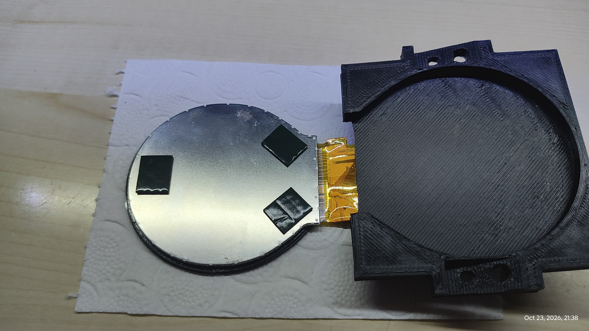
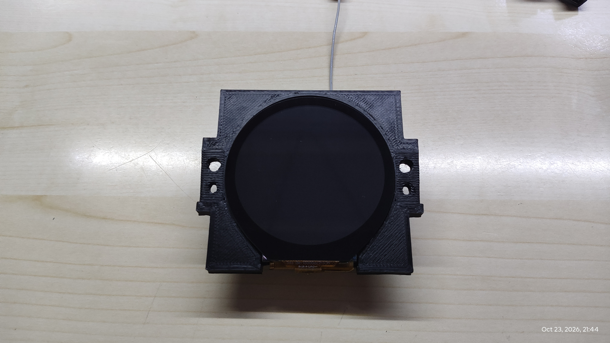
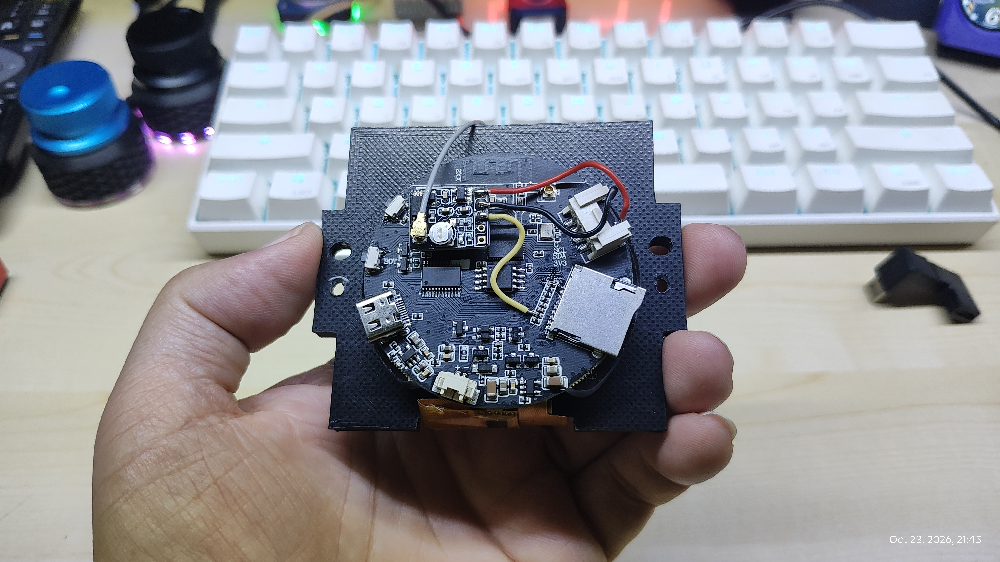
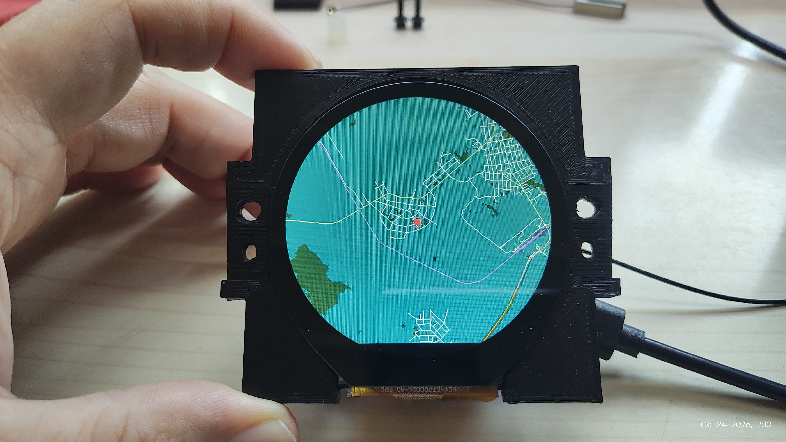

# ESP32-S3 Offline GPS Maps

An offline GPS map display running on an ESP32-S3 with a 480 × 480 round display.

The project renders vector map data stored locally on the device, so the map does not require an internet connection. GPS position updates move the map as you travel.

## Video

[](https://youtu.be/yi_knFQ-pgQ)

▶ [Watch the video on YouTube](https://youtu.be/yi_knFQ-pgQ)

## Build Photos

### Photo 1


### Photo 2


### Photo 3


### Photo 4


## Features

- Offline vector maps stored in the device's flash filesystem.
- GPS-based map positioning.
- Roads and forest areas rendered from local vector data.
- Map display on a 480 × 480 round screen.
- Zoom control with the selected zoom level saved between restarts.
- GPS data received over a serial connection.

## Hardware

- ESP32-S3 development hardware
- LILYGO T-RGB 2.1-inch round display
- GPS receiver connected over UART

## Map data

The `data` directory contains the vector map files:

- `chernik.vec` — main map data
- `forests.vec` — forest polygons

The map data is stored in FFat on the ESP32-S3. The `.vec` files must be uploaded to the device's filesystem separately from the Arduino sketch.

## Software

The project is developed using the Arduino framework.

Libraries used by the sketch include:

- Arduino_GFX
- TinyGPS++
- Wire
- EEPROM
- FFat

The sketch uses the ESP32-S3's PSRAM for the map framebuffer.

## Project structure

```text
ESP32-S3-Offline-GPS-Maps/
├── README.md
├── .gitignore
└── ESP32-S3-Offline-GPS-Maps/
    ├── ESP32-S3-Offline-GPS-Maps.ino
    └── data/
        ├── chernik.vec
        └── forests.vec
```

## Getting started

1. Clone or download this repository.
2. Open `ESP32-S3-Offline-GPS-Maps.ino` in the Arduino IDE.
3. Install the required libraries and configure the ESP32-S3 board for your hardware.
4. Upload the sketch to the board.
5. Upload the vector map files to the device's FFat filesystem using a compatible filesystem upload method.
6. Connect the GPS receiver and start the device outdoors for GPS reception.

The correct board configuration, filesystem upload method and GPS wiring depend on the hardware setup.

## License

The software in this repository is licensed under the
[PolyForm Noncommercial License 1.0.0](https://polyformproject.org/licenses/noncommercial/1.0.0).

You may use, study, modify, and redistribute the software for non-commercial purposes
under the terms of the license. Commercial use requires separate permission from
the copyright holder.

This project is source-available, not officially open source, because commercial use
is restricted.

The license applies to the software authored for this project. Map data, photographs,
and third-party libraries may have separate copyright or licensing terms.
